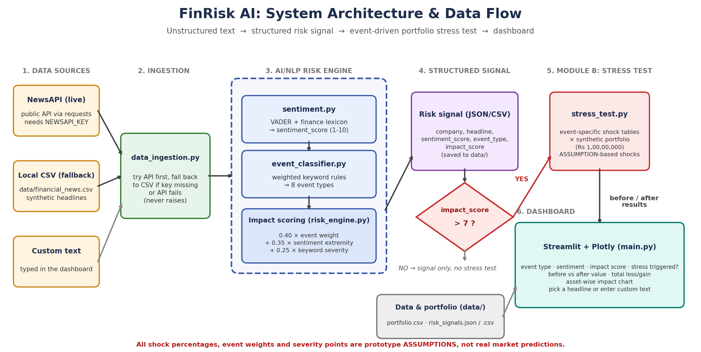

# FinRisk AI: AI-Powered Financial Risk Intelligence & Stress Testing Platform - S&P Global & Crisil Campus Hackathon

**Candidate Name:** Hima Agarwal
**College Email ID:** [hima.24bce10633@vitbhopal.ac.in]
**College / Campus:** VIT Bhopal University
**Demo Video Link:** https://youtu.be/6XBeXS6_SW4?si=slWE46omuLbArPBU

> **Important:** every shock percentage, event weight and severity score in this project is a **prototype assumption** chosen for demonstration. They are **not real market predictions**, and nothing here is financial advice.

---

## 1. Project Overview / Problem Statement & Approach

Financial risk teams receive a constant stream of unstructured text (news, regulatory announcements, social posts), but a portfolio manager needs structured, machine-readable signals and a quick answer to one question: *"If this event is serious, what happens to our portfolio?"*

FinRisk AI is a prototype that turns raw headline text into structured risk signals and uses them to drive an event-driven stress test (Module B of the case study).

**Approach**
1. **Ingest** headlines from two sources: NewsAPI (live) and a local CSV. If the API key is missing or the API fails, the system falls back to the CSV automatically, so the demo never breaks.
2. **Analyze** each headline with a rule-based NLP engine that outputs a sentiment score (1-10), an event type (8 categories) and an explainable impact score (1-10).
3. **Trigger** a stress test when `impact_score > 7`.
4. **Simulate** the event on a synthetic Rs 1,00,00,000 portfolio of five asset classes using event-specific shock tables.
5. **Visualize** the signal, the before/after portfolio value, the total loss or gain and the asset-wise impact in a Streamlit dashboard.

**Structured signal produced for every headline**
```json
{
  "company": "Global Markets",
  "headline": "Military conflict escalates in Middle East; oil prices spike and global markets crash",
  "sentiment_score": 1.4,
  "event_type": "Geopolitical",
  "impact_score": 9.3
}
```
The saved files in `data/risk_signals.json` and `data/risk_signals.csv` also include `stress_test_triggered`, matched severity keywords and the impact breakdown.

**Impact score (explainable, not a black box)**
```
impact_score = 0.40 × event_weight + 0.35 × sentiment_extremity + 0.25 × keyword_severity
```
Each component is on a 0-10 scale. Positive news counts at half weight in the extremity term because it is less of a downside risk. The dashboard shows the breakdown for every headline.

---

## 2. Architecture & Tech Stack



```
 NewsAPI (live) ──┐
                  ├─► data_ingestion.py ─► nlp_engine.py ─► risk_engine.py
 CSV (fallback) ──┘     (auto-fallback)      (pipeline)       │
                                                  ├─ sentiment.py        (VADER + finance lexicon)
                                                  └─ event_classifier.py (weighted keyword rules)
                                                                 │
                                         structured risk signal (JSON/CSV)
                                                                 │
                                          impact_score > 7 ?  ──► stress_test.py
                                                                 │      (shock tables × synthetic portfolio)
                                                                 ▼
                                                      Streamlit dashboard (Plotly)
                                                      src/main.py
```

**Tech stack:** Python, pandas, requests, python-dotenv, VADER sentiment (`vaderSentiment`), Streamlit, Plotly.

**Key design choices**
- **Rule-based NLP, no model training:** fast, fully explainable and reliable offline. VADER is extended with a finance-specific word list because plain VADER misses terms like "downgrade", "default" and "slump".
- **Never-fail ingestion:** the live API is optional, and the CSV fallback guarantees the demo works without internet.
- **Modular files:** each stage (ingestion, sentiment, classification, risk scoring, stress test, UI) is a separate module that can be tested on its own.

**Repository structure**
```
vitbhopal-hima-agarwal-hackathon/
├── README.md
├── requirements.txt
├── LICENSE
├── .env.example
├── src/
│   ├── main.py              # Streamlit dashboard
│   ├── data_ingestion.py    # NewsAPI + CSV fallback
│   ├── nlp_engine.py        # unified pipeline
│   ├── sentiment.py         # VADER + finance lexicon
│   ├── event_classifier.py  # event type rules
│   ├── risk_engine.py       # impact score + structured signals
│   └── stress_test.py       # Module B shock tables + simulation
├── data/
│   ├── financial_news.csv   # synthetic headlines
│   ├── portfolio.csv        # synthetic Rs 1 crore portfolio
│   ├── risk_signals.json    # generated output
│   └── risk_signals.csv     # generated output
└── docs/
    ├── presentation.pdf
    └── architecture.png
```

---

## 3. Dataset Used

| Data | Source / nature | Notes |
|---|---|---|
| `data/financial_news.csv` | **Synthetic.** 20 headlines written for this prototype, covering all event types | Used as the guaranteed fallback and for the demo |
| NewsAPI headlines | **Public API, optional.** Live headlines from newsapi.org when `NEWSAPI_KEY` is set in `.env` | Not required to run. No API data is stored in the repo |
| `data/portfolio.csv` | **Synthetic.** Rs 1,00,00,000 across Govt Bonds 30L, Corporate Bonds 20L, Loans 20L, Equity 20L, Derivatives 10L | No real client or proprietary data |

**Assumptions**
- Headlines are short single sentences. Company names are taken from the CSV; NewsAPI headlines are tagged "Market News" because the API gives no company field.
- Event weights, severity-keyword points and all stress-test shock percentages are **illustrative assumptions**, not calibrated to historical market data.
- The portfolio is a single static synthetic portfolio. No real client or confidential data is used anywhere in this project.

---

## 4. Quickstart & Installation

**Runtime:** Python [3.11 - fill in the output of `python --version`] on [Windows 11 - fill in your OS]

```bash
git clone <your-repo-url>
cd vitbhopal-hima-agarwal-hackathon
python -m venv .venv
# Windows PowerShell:  .venv\Scripts\Activate.ps1
# macOS / Linux:       source .venv/bin/activate
pip install -r requirements.txt
streamlit run src/main.py
```

The app opens at `http://localhost:8501`.

**Optional: live news.** Copy `.env.example` to `.env` and set `NEWSAPI_KEY=your_key`. Without a key, the app uses the CSV automatically.

**Test individual modules** (each prints its results):
```bash
python src/data_ingestion.py
python src/sentiment.py
python src/event_classifier.py
python src/risk_engine.py
python src/stress_test.py
python src/nlp_engine.py
```

---

## 5. Key Results & Domain Impact

**Results on the 20 synthetic headlines:** 20 structured signals were generated and 5 triggered the stress test (impact > 7). The shocks below are assumption-based.

| Headline (short) | Event type | Impact | Portfolio change |
|---|---|---|---|
| Military conflict escalates; markets crash | Geopolitical | 9.3 | -Rs 5,50,000 (-5.5%) |
| Sanctions trigger supply chain fears | Geopolitical | 8.4 | -Rs 5,50,000 (-5.5%) |
| Yes Bank downgrade, loan default fears | Financial Performance | 7.7 | -Rs 5,30,000 (-5.3%) |
| Recession fears, GDP contracts | Macroeconomic | 7.6 | -Rs 5,20,000 (-5.2%) |
| SEBI probe into Adani over manipulation | Regulatory | 7.3 | -Rs 4,50,000 (-4.5%) |

Positive or routine headlines (for example record profit or a product launch) score low and correctly do **not** trigger a stress test.

**Domain impact**
- Converts unstructured text into structured signals that downstream tools (dashboards, risk systems) can consume.
- Gives a transparent, explainable link from an event to a portfolio-level loss figure, which is useful for early-warning and scenario discussion in wholesale banking.
- Every score can be traced back to its components, which supports model-risk and audit conversations.

**Limitations and next steps**
- Rule-based sentiment and classification can miss sarcasm, negation and unusual phrasing. Next step: swap in FinBERT or a zero-shot classifier behind the same function interfaces.
- Results have not been validated against labelled data or historical market moves, so no accuracy claims are made.
- Shock tables are static assumptions. Next step: calibrate them with historical price data (for example via `yfinance`) and scale shocks by impact score.
- Single static portfolio. Next step: upload custom portfolios and add the GDELT feed for broader real-time coverage.

---

## License
MIT. See `LICENSE`.